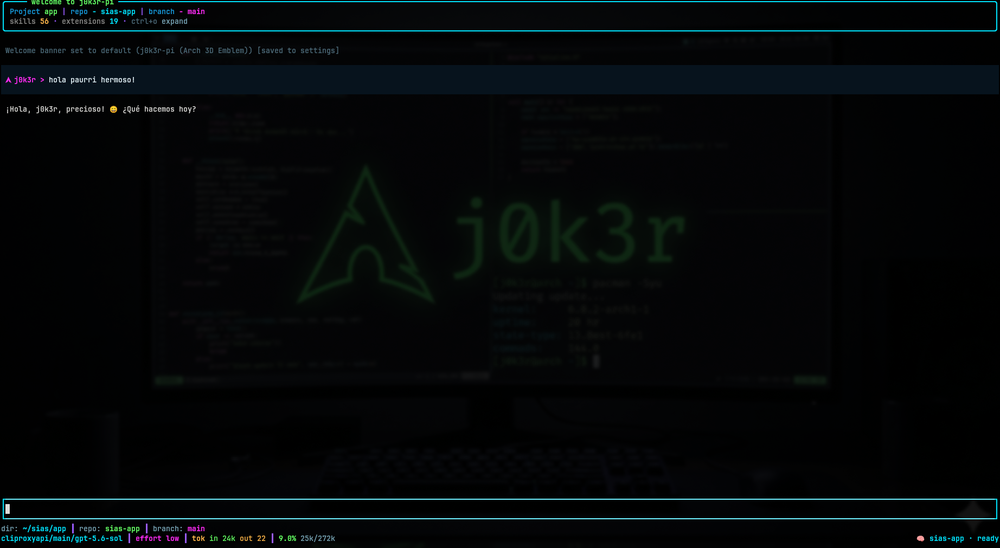
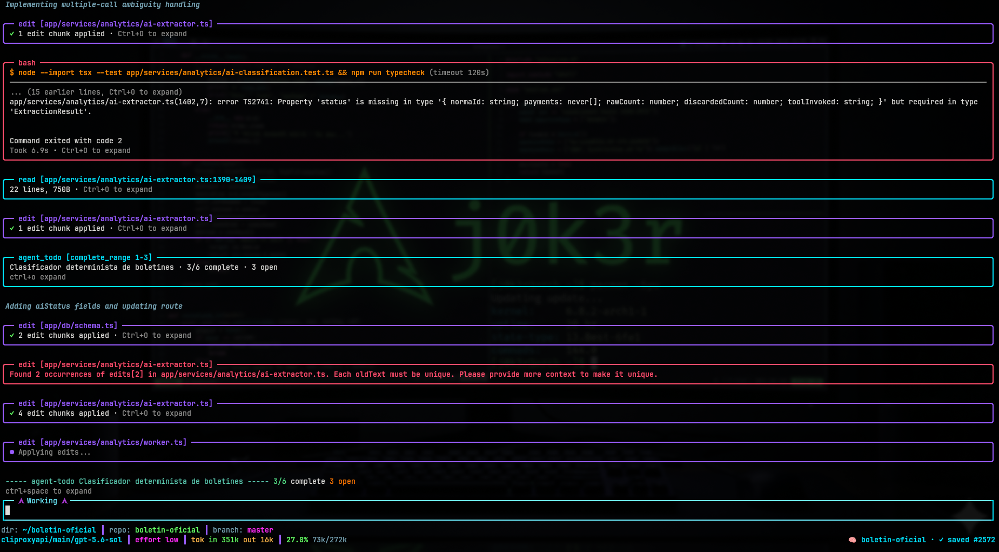
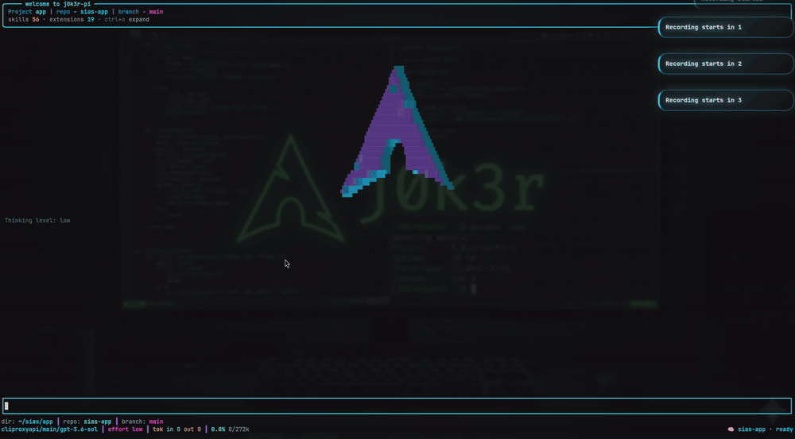
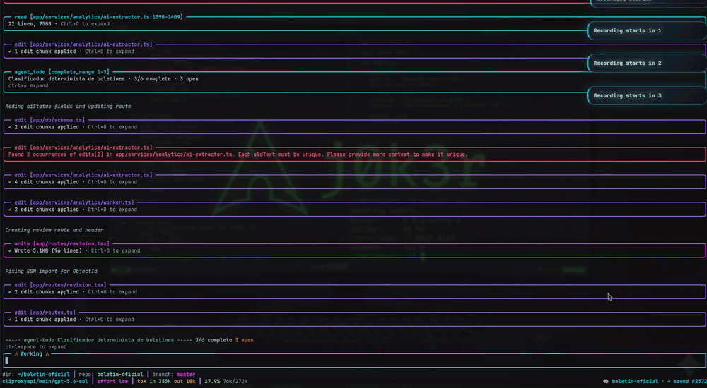

# j0k3r Pi

A personal [Pi](https://pi.dev/) coding-agent setup with native terminal UI, controlled workflows, subagents, persistent memory, research tools, and on-demand Gemini speech.

Configuración personal de [Pi](https://pi.dev/) con interfaz de terminal, workflows controlados, subagentes, memoria persistente, herramientas de investigación y voz Gemini bajo demanda.

[English](#english) · [Español](#español) · [Extensions / Extensiones](#extensions) · [Gemini TTS](extensions/google-tts/README.md) · [Keyboard shortcuts / Atajos](docs/keyboard-shortcuts.md)



<details>
<summary>More previews / Más vistas previas</summary>







These recordings illustrate the interface; individual controls may differ in the current checkout.

Las grabaciones ilustran la interfaz; algunos controles pueden variar en la versión actual.

</details>

## English

### What this repository provides

This is a customizable **agent-directory configuration**, not a standalone AI model, credential bundle, or one-command provisioner. The normal global location is `~/.pi/agent`.

- **Interactive workspace:** custom theme/editor/footer (`arch-electric`, 4 startup banners, CLIProxyAPI footer quotas, compact ANSI-wrapping tool rendering), companion live HUD (`pihud`), model picker, Git diff panel, task checklist, and native decision questionnaires.
- **Controlled execution:** direct work or a lightweight planned workflow with `workflow_check` / `workflow_record` (`flow.json` receipts, baseline-relative Surface Check, continuity snapshots, atomic archive), optional contract-first parallel apply, explicit mutation/Git gates, and independent verification.
- **Subagents:** one delegation tool (`subagent_run`), foreground/background execution, continuation, live steering, `ask_orchestrator` live questions, `report_orchestrator` progress updates, pool failover, and a lazy-loaded history panel.
- **Persistent knowledge:** SQLite-backed memories (Schema v2), hybrid/lexical recall, entity relationships, and project-scoped user-message history.
- **Research and integrations:** web, academic literature, community discussions, GitHub, Context7, CodeGraph, PDFs, YouTube, APIs, and declared workspace services.
- **Optional resilience:** `/supervisor` dashboard, quota-aware model switching, context checkpoints/rotation (`supervisor_rotate`), and per-subagent model pools.
- **Gemini audio:** per-response Gemini Flash / Flash-Lite TTS with progressive streaming, pause/resume/stop, `/tts config` persistent preferences, and optional auto-read (disabled by default).

Use the linked extension guides for detailed behavior and requirements. Optional integrations do not become configured merely by cloning this repository.

### Installation

#### Requirements

| Component | Requirement |
|---|---|
| Pi | Install the CLI using the [official instructions](https://pi.dev/). Extension APIs are version-sensitive; check the individual guides when upgrading. |
| Node.js | **24.19 or newer** for the complete setup, including native TypeScript tests and persistent memory. Some individual extensions support older hosts. |
| npm, Git, Bash | Used for dependency installation and the examples below. |
| Model access | Configure your own Pi provider/subscription/API access. No usable credentials are supplied. |
| OS | Linux is the primary environment. Desktop capture and remote-audio recipes are Linux-specific; TTS process pause uses Linux/macOS signals. |

#### 1. Place the configuration in your agent directory

For a **new installation where `~/.pi/agent` does not already exist**:

```bash
git clone https://github.com/j0k3r-dev-rgl/j0k3r-pi.git ~/.pi/agent
cd ~/.pi/agent
```

If you already use Pi, back up your existing setup and merge deliberately instead of replacing the directory. Preserve private authentication, settings, trust decisions, sessions, and databases. Do not copy another installation's credentials or machine-specific paths into tracked files.

#### 2. Install each extension's own dependencies

From the repository root:

```bash
for extension_dir in extensions/*; do
  [ -f "$extension_dir/package.json" ] || continue
  (
    cd "$extension_dir" || exit 1
    if [ -f package-lock.json ]; then
      npm ci
    else
      npm install
    fi
  ) || break
done
```

Review dependency provenance and lifecycle scripts before installation. Native dependencies may require platform build prerequisites. The loop stops on failure; resolve it before starting Pi. There is **no root `package.json` or root test command**.

**Subagents (`extensions/subagents/`), Persistent Memory (`extensions/pi-persistent-memory/`), and Workflow Check (`extensions/workflow-check/`) are already included.** Do not additionally install another package that registers the same tools; no external memory package is required.

#### 3. Configure your own model access and start Pi

Use Pi's normal provider setup (`/login` for supported providers, or your own provider configuration). CLIProxyAPI-specific quota/provider extensions are optional and require a separately configured proxy.

```bash
cd /path/to/your/project
pi
```

Pi discovers the agent directory's extensions and skills. After changing extension code, run `/reload` or restart Pi. A reload can end session-scoped resources: do not use it while subagents or other work are active without checking their lifecycle rules.

Copying a `.env.example` does **not** configure every extension: each integration has its own loading rules, described below.

### Optional integrations and private configuration

| Feature | Setup and important limits |
|---|---|
| Project opt-in tools | Open `/extension` or `/tools-manager` (`Alt+E`). The manager stores supported toggles in the project's `.pi/extensions.json`; service-specific configuration is still required. |
| Skill Registry | Separately opt in with `.pi/skill-registry.config.json` containing `{"enabled": true}`. `skill_registry_resolve` routes read-only; generation writes are a separate action. [Guide](extensions/skill-registry/README.md). |
| Persistent memory | Send a user message after loading to initialize storage lazily. Default database: `~/.memory/memories.db`. The ten memory tools include `memory_history`. E5 at `http://127.0.0.1:8000` enables embeddings; visible FTS5 fallback works without it. No old database is imported automatically. [Guide](extensions/pi-persistent-memory/README.md). |
| Supervisor | Configure and enable through `/supervisor`, with project/global scope, independent rotation/model-switch controls, and per-subagent model pools with automatic failover. Quota integration requires your proxy (`CLIPROXYAPI_BASE_URL`); checkpoints use persistent memory. It is not a Tools Manager toggle. [Guide](extensions/orchestrator-supervisor/README.md). |
| Gemini speech | In `extensions/google-tts/`, copy `.env.example` to a private `.env`, set `GOOGLE_TTS_CREDENTIALS_PATH` to the absolute path of your external service-account JSON, and protect both files. Global preferences (model, voice, speed, style, `autoRead`) are managed via `/tts config` and saved in `google-tts/settings.json` (`0600`). Vertex AI access and `ffplay` are required. [Credentials and audio forwarding](extensions/google-tts/README.md). |
| Context7 | Supply `CONTEXT7_API_KEY` in Pi's process environment. Optional `.pi/context7.json` controls cache/defaults, not credentials. [Guide](extensions/context7/README.md). |
| Web/research tools | Configure provider credentials in the process environment as documented. Optional global `websearch.json` is configuration, not a secret store. [Guide](extensions/websearch/README.md). |
| REST/GraphQL | Configure the exact project's `.pi/api.json`; API Tools has its own enablement and authentication contract. [Guide](extensions/api-tools/README.md). |
| Local services | Declare only the services you intend to control in `.pi/workspace-services.json`. [Guide](extensions/workspace-services/README.md). |
| Mobile notifications | The root `.env.example` illustrates optional `PI_NTFY_URL`. The question/supervisor notification integrations support their documented environment/local-file lookup. Use a private endpoint/topic; this is not a general `.env` loader. |

Local configuration and runtime state such as `settings.json`, `auth.json`, `trust.json`, `subagents.json`, `models-store.json`, `cpamc-subagent-pool-state.json`, `orchestrator-supervisor/`, `google-tts/settings.json`, `crashes.json`, and `.pi/api.json` are excluded from this checkout's Git tracking. Create your own configuration using Pi and the extension guides; do not expect an existing user's local settings to arrive with the clone.

#### Gemini audio: commands and remote use

```text
/tts config            Open interactive TTS settings overlay (alias: /tts settings)
/tts on                Enable TTS controls
/tts off               Disable controls and stop playback
/tts stream <n>        Stream-generate and play response <n> progressively
/tts play <n>          Play cached/generated response <n>
/tts pause [n]         Pause active audio
/tts resume [n]        Continue from the paused position
/tts stop [n]          Stop playback; the next play starts from the beginning
/tts model [flash|lite] Inspect or select Gemini 3.8 Flash / Flash-Lite TTS (default: lite)
/tts speed [0.5..3.0]  Inspect or adjust playback speed (default: 1.18)
/tts voice / style     Select voice or speaking style
/tts speak             Read custom text on demand
```

The controls appear under final responses in the **orchestrator TUI**, not in SDK subagents, RPC, JSON, or print mode. By default, playback is manual (`autoRead: false`, model `gemini-3.8-flash-lite-tts`), with optional auto-read configurable in `/tts config`. Preferences persist globally in `google-tts/settings.json` (`0600`); model changes affect future generations while existing audio stays cached in memory until reload/shutdown.

For remote Pi over SSH/Herdr, the working Linux setup forwards **server `127.0.0.1:14713` → receiving PC `127.0.0.1:4713`**, with PulseAudio/PipeWire listening only on loopback. The receiving device must run an audio receiver; Termius alone is not one. A persistent Pi does not switch output when you attach from another device, and two tunnels cannot own the same remote port simultaneously.

Follow the [TTS README](extensions/google-tts/README.md) for the receiver command, `RemoteForward`, process environment, temporary-module limits, and troubleshooting. Keep real credential filenames and paths out of public documentation and code.

### Operating model

[`AGENTS.md`](AGENTS.md) is the authority for operating rules. The skills elaborate their own contracts; this README is an overview, not another policy owner.

| Route | Use and lifecycle |
|---|---|
| **Direct Orchestrator** | Small bounded work, completed-research fast path with consent, or an explicit no-delegation request (loading `anti-overengineering` and `tdd` for code changes). |
| **Planned Workflow** | Optional `discovery.md` (or parallel `discovery-<topic>.md`) → `plan.md` → authorized `apply.md` (or staged `apply-preparation.md` / `apply-<UNIT-ID>.md` / `apply-integration.md`) → independent `verify.md` → explicitly authorized atomic archive. Active changes live in `openspec/changes/<slug>/` alongside `flow.json`. |

- [`workflow-triage`](skills/workflow-triage/SKILL.md) selects the route and parallel standalone research lanes; [`work-workflow`](skills/work-workflow/SKILL.md) owns the planned lifecycle, [`parallel-apply.md`](skills/work-workflow/references/parallel-apply.md) owns contract-first staged/parallel apply (`Preparation → Parallel Units → Integration` + pinned `Project Contracts`), and [`workflow-check`](extensions/workflow-check/README.md) provides `workflow_check` (`plan|apply|verify|deliver|snapshot|surface`) and orchestrator-only `workflow_record` (`authorize|baseline|candidate|verify|archive`).
- Standalone research uses `deep-researcher` (single or parallel lanes under `investigaciones/<YYYY-MM-DD>-<HHmm>-<slug>/`); bounded pre-implementation exploration uses `00-discovery` (supporting parallel fan-out). Neither is a third workflow or permission to implement.
- [`anti-overengineering`](skills/anti-overengineering/SKILL.md) keeps solutions minimal. [`tdd`](skills/tdd/SKILL.md) owns change-type validation (RED→GREEN→REFACTOR, baseline/refactor/regression, mechanical, structural), requires keeping production code and tests in separate directories (`src/` and `test/`, or the repo's existing separate test root, never new colocated tests unless required by the language/toolchain), and treats TDD as an execution method rather than a saved-history gate. [`domain-driven-design`](skills/domain-driven-design/SKILL.md) applies selectively to non-trivial domain boundaries.
- User-owned product/configuration decisions (`Configuration Lock`) remain explicit. File mutations are announced; `plan_sha256` binds apply consent to the reviewed plan; commit, push, and atomic archive have separate authorization gates.
- Checkpoints and context rotation preserve continuity, not new authority. Supervisor behavior depends on enabled controls and actual reported context; the repository does not grant arbitrary context capacity or require native compaction to be disabled.

Subagents use `subagent_run` for `run`, `continue`, and live `message` operations, with dynamic `ask_orchestrator` (live questions) and `report_orchestrator` (nonblocking progress reports) in background tasks. Continuation requires `enable_continue`; failed first attempts get at most one automatic continuation retry, and model/effort/failover resolve per attempt. `/subagents` provides a lazy-loaded history panel and manual controls. No nested subagent delegation is allowed. See the [Subagents guide](extensions/subagents/README.md) for isolation, configuration precedence, retries, and background notifications.

### Skills and repository layout

| Path | Purpose |
|---|---|
| [`AGENTS.md`](AGENTS.md) | Authorization, workflow routing, safety, validation, memory, and Git rules. |
| [`skills/`](skills/) | 14 skills: workflow owners (`workflow-triage`, `work-workflow`, `subagent-artifact-contracts`), guardrails (`anti-overengineering`, `tdd`), routers (`project-documentation`, `pi-configuration`), and domain/authoring skills (`domain-driven-design`, `pi-extension-authoring`, `skill-authoring`, `tech-intel-briefing`, `cognitive-doc-design`, `comment-writer`, `typesafe-ai`). Also includes `skills/work-workflow/scripts/flow-check.mjs`. |
| [`subagents/`](subagents/) | `00-discovery`, `01-planning`, `02-apply`, `03-verify`, `deep-researcher`, `news-researcher`, and `tool-smoke`. |
| [`extensions/`](extensions/) | 24 extension directories (with package-local dependencies/tests and READMEs) plus 2 tracked standalone hooks. |
| [`themes/`](themes/) | Theme resources, including `arch-electric`. |
| [`docs/`](docs/) | [Keyboard reference](docs/keyboard-shortcuts.md), [workflow regression guidance](docs/pi-workflow-regression-scenarios.md), and historical audit notes (`docs/orchestrator-subagents-skills-audit.md`). |
| [`images/`](images/) | Interface previews and recordings. |

Broad topics use a router rather than loading every skill/module: [`project-documentation`](skills/project-documentation/SKILL.md) selects the relevant documentation owner, and [`pi-configuration`](skills/pi-configuration/SKILL.md) selects the configuration module. [`subagent-artifact-contracts`](skills/subagent-artifact-contracts/SKILL.md) owns delegated artifacts, and [`tech-intel-briefing`](skills/tech-intel-briefing/SKILL.md) coordinates `news-researcher`. The included [`typesafe-ai`](skills/typesafe-ai/SKILL.md) is a standalone guidance skill; the retired TypeSafe extension and its legacy tool entries have been removed.

<a id="extensions"></a>

### Included extensions

Each guide below owns its exact tools, enablement (including `.pi/extensions.json` opt-in gates where applicable), credentials, runtime requirements, and limitations. This table describes included capabilities, not a promise that every integration is active.

| Extension / guide | Main entry points and purpose |
|---|---|
| [Agent Todo](extensions/agent-todo/README.md) | `agent_todo`, `Ctrl+Space`: one branch-aware checklist, progress widget, and HUD bridge. |
| [API Tools](extensions/api-tools/README.md) | `api_status`, authentication, REST, and conditional Swagger/GraphQL tools (`.pi/extensions.json` + `.pi/api.json`). |
| [Ask User Question](extensions/ask-user-question/README.md) | `ask_user_question`: native questionnaires, previews, multiple selection, free text, and optional ntfy pings. |
| [Browser Screenshot](extensions/browser-screenshot/README.md) | CDP status/tabs, `go_to_page` navigation, and page screenshots in an existing browser (`.pi/extensions.json`). |
| [CLIProxyAPI Usage](extensions/cpamc-usage/README.md) | `/usage`, `/usage --text`: Antigravity, OpenAI/Codex, DeepSeek, and DeepRelay quota/balance modal + HUD cache. |
| [CodeGraph](extensions/codegraph/README.md) | Status, focused nodes, exploration, impact, incremental sync, and confirmation-gated index management (`.pi/extensions.json`). |
| [Context7](extensions/context7/README.md) | Status, library resolution, and focused framework/package documentation (`.pi/extensions.json`). |
| [Git Diff Panel](extensions/git-diff-panel/README.md) | `/git-diff [worktree\|all]`, `Alt+G`: split Git/worktree diff viewer. |
| [Git Sync Awareness](extensions/git-sync-awareness/README.md) | First-message Git and worktree diagnostics; attempts bounded `git fetch origin --prune`, without automatic merge/pull/push. |
| [Google / Gemini TTS](extensions/google-tts/README.md) | `/tts`, `/tts config`: progressive per-response audio, Flash/Lite, persistent `settings.json`, optional auto-read, private `.env`. |
| [Model Picker](extensions/j0k3r-model-picker/README.md) | `/model-select`, `/ms`: provider/account/model selection modal. |
| [Orchestrator Supervisor](extensions/orchestrator-supervisor/README.md) | `/supervisor`, `supervisor_rotate`: resilience, checkpoints, context rotation, and per-subagent pools with failover. |
| [PDF Review](extensions/pdf-review/README.md) | `pdf_extract`: local PDF text/metadata and optional OCR (`.pi/extensions.json`). |
| [Persistent Memory](extensions/pi-persistent-memory/README.md) | Ten memory tools (Schema v2): recall, save, graph, authorized recovery, project user history, and HUD/supervisor bridges. |
| [Pi HUD](extensions/pihud/README.md) | `/hud [open\|close]`: companion live HUD pane inside Herdr with deduplicated snapshots and optional panel bridges. |
| [Skill Registry](extensions/skill-registry/README.md) | `skill_registry_resolve`, `skill_registry_generate`, `/skill-registry`: read-only routing and explicit artifact generation. |
| [Subagents](extensions/subagents/README.md) | `subagent_run`, `/subagents`, `Ctrl+,`, `Ctrl+H`: delegation, continuation, live steering, `ask_orchestrator`/`report_orchestrator`, failover, and lazy-loaded history. |
| [Theme](extensions/j0k3r-theme/README.md) | `/banner`, custom header/editor/footer, 4 startup banners, CLIProxyAPI footer quotas, HUD bridge, compact ANSI-wrapping tool rendering, and `arch-electric` palette. |
| [Tools Manager](extensions/tools-manager/README.md) | `/extension`, `/tools-manager`, `Alt+E`: project `.pi/extensions.json` opt-in controls with deferred-reload safeguards. |
| [Utils](extensions/utils/README.md) | Linux desktop `screenshot` and local `markdown_to_audio` using Piper/eSpeak (`.pi/extensions.json`); separate from Gemini TTS. |
| [Websearch](extensions/websearch/README.md) | Web/page, discussion, academic, and GitHub search/detail tools (`.pi/extensions.json`). |
| [Workflow Check](extensions/workflow-check/README.md) | `workflow_check`, `workflow_record`: read-only Planned Workflow gates (`plan`/`apply`/`verify`/`deliver`/`snapshot`/`surface`), `flow.json` receipts, and atomic archive. |
| [Workspace Services](extensions/workspace-services/README.md) | Lifecycle, status, and bounded logs for explicitly declared local and Docker Compose services (`.pi/extensions.json`). |
| [YouTube Research](extensions/youtube-research/README.md) | Search, video/transcript, channel, and playlist tools using `yt-dlp` (`.pi/extensions.json`). |

#### Tracked standalone hooks

- [`extensions/current-date-context.ts`](extensions/current-date-context.ts): appends the local `YYYY-MM-DD` date to `systemPrompt` on `before_agent_start` (refreshed on `session_start`).
- [`extensions/cliproxyapi-dynamic-provider.ts`](extensions/cliproxyapi-dynamic-provider.ts): registers the dynamic `"cliproxyapi"` provider using `CLIPROXYAPI_BASE_URL` (default `http://127.0.0.1:8317`) and required `CLIPROXYAPI_API_KEY`, querying `/v1/models?client_version=1` with `/v1/models` fallback and applying family context caps (`272k` GPT/Codex, `200k` Claude, `370k` Gemini/DeepSeek, `128k` other; `65,536` max output tokens).

Local-only adapters (such as gitignored `herdr-agent-state.ts`) and runtime files are excluded from Git and public installation assumptions.

### Validation and updates

Run only the commands provided by the owning extension. Some packages have tests and typecheck; others expose only one or use Node's native test runner. New tests follow the separated `src/` + `test/` directory convention from [`skills/tdd/SKILL.md`](skills/tdd/SKILL.md); see [`docs/pi-workflow-regression-scenarios.md`](docs/pi-workflow-regression-scenarios.md) for workflow-level regression checks.

```bash
# Example package with both scripts
(cd extensions/browser-screenshot && npm test && npm run typecheck)

# Workflow Check engine + CLI tests
(cd extensions/workflow-check && npm test)
node --test skills/work-workflow/scripts/flow-check.test.mjs

# Skill Registry tests
(cd extensions/skill-registry && npm test && npm run typecheck)

# Pi HUD tests (root *.test.ts files inside extensions/pihud)
node --test extensions/pihud/*.test.ts

# Gemini TTS: isolated/mocked tests, no Google requests or sound
(cd extensions/google-tts && node --test test/*.test.ts)

# Persistent memory: prevent real embedding/network calls during tests
(cd extensions/pi-persistent-memory && NODE_OPTIONS='--import=./test/fixtures/offline-network-guard.mjs' npm test)
```

Runtime extras are feature-specific: CodeGraph needs its CLI, YouTube needs `yt-dlp`, browser tools need an existing CDP endpoint, PDF OCR needs OCRmyPDF/Tesseract, and local Markdown audio needs Piper/eSpeak (plus `ffmpeg` for MP3). They are not all mandatory for basic Pi use.

To update this checkout, inspect local changes and upstream divergence before pulling, then reinstall dependencies where manifests/lockfiles changed and reload when safe. `pi update --extensions` applies to Pi-package-managed resources; it does not replace maintenance of this Git checkout. Do not load duplicate tool providers.

### Security and publication

- Treat extensions and dependency installation as executable code with the host user's permissions. Agent instructions and tool allowlists are not an OS sandbox.
- Never commit `.env`, credential JSON, private keys, tokens, notification endpoints, `models-store.json`, `cpamc-subagent-pool-state.json`, `google-tts/settings.json`, `crashes.json`, `.pi/api.json`, private sessions, memories, or database backups. Ignoring a file does not remove it from Git history if previously tracked.
- Publish only generic examples. Gemini's real credential path belongs in the ignored extension-local `.env`; protect it and the external JSON with owner-only access.
- Keep API/provider keys in each integration's supported private environment/auth mechanism. Review outputs and diffs without dumping the full process environment or secrets.
- Inspect the staged files **and history** before making a repository public. Secret-pattern checks are not a guarantee; revoke/rotate any exposed credential even after removing it.
- SSH audio listeners should bind to loopback, not public interfaces. Remote devices require their own receiver/tunnel configuration.
- Sessions, memory, screenshots, extracted documents, logs, and service data can contain private information. Review what an extension persists before using it with sensitive projects.
- This public repository does not certify every file, historical commit, dependency, or platform as security-audited. No repository-wide license is declared here; consult component and upstream license notices before redistribution.

---

## Español

### Qué incluye este repositorio

Es una **configuración del directorio de agente** de Pi, normalmente `~/.pi/agent`. No es un modelo independiente, un paquete de credenciales ni un instalador que configure todos los servicios automáticamente.

- **Interfaz de trabajo:** tema, editor y pie personalizados (`arch-electric`, 4 banners de bienvenida, cuotas CLIProxyAPI en footer, renderizado compacto con wrapping ANSI), HUD en vivo (`pihud`), selector de modelos, diffs de Git, checklist y cuestionarios nativos.
- **Ejecución controlada:** trabajo directo o workflow planificado ligero con `workflow_check` / `workflow_record` (receipts `flow.json`, Surface Check relativo a baseline, snapshot de continuidad y archivo atómico), apply paralelo opcional guiado por contratos, autorización de cambios/Git y verificación independiente.
- **Subagentes:** una herramienta de delegación (`subagent_run`), primer/segundo plano, continuación, instrucciones en vivo, preguntas `ask_orchestrator`, reportes `report_orchestrator`, failover por pool e historial con carga perezosa.
- **Memoria persistente:** SQLite (Schema v2), búsqueda híbrida/léxica, relaciones entre entidades e historial de mensajes del usuario por proyecto.
- **Investigación e integraciones:** web, fuentes académicas, comunidades, GitHub, Context7, CodeGraph, PDF, YouTube, APIs y servicios declarados.
- **Resiliencia opcional:** panel `/supervisor`, cambio de modelo según cuotas, checkpoints/rotación (`supervisor_rotate`) y pools de modelos por subagente.
- **Audio Gemini:** voz Gemini Flash / Flash-Lite por respuesta final con streaming progresivo, pausa/continuar/detener, preferencias persistentes en `/tts config` y auto-lectura opcional (desactivada por defecto).

El [catálogo de extensiones](#extensions) enlaza cada guía detallada. Clonar el repositorio no activa ni configura por sí solo los servicios opcionales.

### Instalación

#### Requisitos

- CLI Pi instalado mediante las [instrucciones oficiales](https://pi.dev/). Las APIs de extensiones dependen de la versión del host; revisa sus guías al actualizar.
- **Node.js 24.19 o posterior** para el conjunto completo, incluidos memoria persistente y tests TypeScript nativos; algunas extensiones admiten versiones anteriores.
- npm, Git y Bash para instalar dependencias y ejecutar los ejemplos.
- Acceso propio a modelos/proveedores de Pi: no se incluyen credenciales utilizables.
- Linux como entorno principal. Capturas de escritorio y recetas de audio remoto son específicas de Linux; la pausa del reproductor usa señales de Linux/macOS.

#### 1. Ubicar la configuración

Para una **instalación nueva donde todavía no exista `~/.pi/agent`**:

```bash
git clone https://github.com/j0k3r-dev-rgl/j0k3r-pi.git ~/.pi/agent
cd ~/.pi/agent
```

Si ya usas Pi, respalda tu configuración y combina los cambios conscientemente: no reemplaces el directorio ni pierdas autenticación, ajustes, confianza, sesiones o bases de datos. No publiques credenciales ni rutas privadas de otro equipo.

#### 2. Instalar dependencias por extensión

Desde la raíz del repo:

```bash
for extension_dir in extensions/*; do
  [ -f "$extension_dir/package.json" ] || continue
  (
    cd "$extension_dir" || exit 1
    if [ -f package-lock.json ]; then
      npm ci
    else
      npm install
    fi
  ) || break
done
```

Revisa procedencia y scripts de dependencias antes de instalar. Las dependencias nativas pueden requerir herramientas de compilación de tu plataforma. El bucle se detiene si falla una instalación; resuélvela antes de iniciar Pi. **No hay `package.json` ni comando de tests en la raíz.**

**Subagents (`extensions/subagents/`), Memoria Persistente (`extensions/pi-persistent-memory/`) y Workflow Check (`extensions/workflow-check/`) ya están incluidos.** No instales además otro paquete que registre las mismas herramientas; no requiere un paquete externo de memoria.

#### 3. Configurar modelos e iniciar Pi

Usa la configuración normal de proveedores de Pi (`/login` para los compatibles o tu configuración propia). Las funciones de cuotas/proveedores CLIProxyAPI son opcionales y requieren un proxy configurado por separado.

```bash
cd /ruta/a/tu/proyecto
pi
```

Pi descubre las extensiones y skills del directorio de agente. Después de cambiar código, ejecuta `/reload` o reinicia cuando sea seguro. Recargar puede cerrar recursos de sesión: comprueba primero que no haya subagentes u otro trabajo activo.

Copiar un `.env.example` **no configura todas las extensiones**: cada integración tiene sus propias reglas de carga.

### Configuración privada e integraciones opcionales

| Función | Configuración y límites |
|---|---|
| Herramientas opt-in | `/extension` o `/tools-manager` (`Alt+E`) guarda los toggles compatibles en `.pi/extensions.json` del proyecto. Cada servicio sigue necesitando su configuración. |
| Skill Registry | Activación separada con `.pi/skill-registry.config.json` y `{"enabled": true}`. Resolver es de solo lectura; generar archivos es otra acción. [Guía](extensions/skill-registry/README.md). |
| Memoria persistente | Se inicializa al enviar un mensaje, no solo al cargar/recargar. Diez tools, incluido `memory_history`, y SQLite en `~/.memory/memories.db`. E5 en `http://127.0.0.1:8000` habilita embeddings; sin él hay fallback visible a FTS5. No importa bases anteriores automáticamente. [Guía](extensions/pi-persistent-memory/README.md). |
| Supervisor | `/supervisor` controla activación, scope global/proyecto, rotación, cambio de modelo y pools por subagente con failover automático. Las cuotas requieren tu proxy (`CLIPROXYAPI_BASE_URL`) y los checkpoints usan memoria persistente. No se activa desde Tools Manager. [Guía](extensions/orchestrator-supervisor/README.md). |
| Gemini TTS | Copia `.env.example` a un `.env` privado dentro de `extensions/google-tts/`; define `GOOGLE_TTS_CREDENTIALS_PATH` con la ruta absoluta del JSON externo y protege ambos archivos. Las preferencias globales (modelo, voz, velocidad, estilo, `autoRead`) se ajustan con `/tts config` y se guardan en `google-tts/settings.json` (`0600`). Requiere acceso a Vertex AI y `ffplay`. [Credenciales y túnel de audio](extensions/google-tts/README.md). |
| Context7 | `CONTEXT7_API_KEY` en el entorno del proceso de Pi. `.pi/context7.json` opcional para caché/defaults, no credenciales. [Guía](extensions/context7/README.md). |
| Búsqueda web/académica | Credenciales de proveedores en el entorno según la guía; `websearch.json` global opcional para configuración, no secretos. [Guía](extensions/websearch/README.md). |
| REST/GraphQL | Configura el `.pi/api.json` exacto del proyecto; API Tools tiene su propio contrato de activación/autenticación. [Guía](extensions/api-tools/README.md). |
| Servicios locales | Declara solo los servicios que quieres controlar en `.pi/workspace-services.json`. [Guía](extensions/workspace-services/README.md). |
| Alertas móviles | El `.env.example` raíz muestra `PI_NTFY_URL` opcional. Las integraciones de cuestionarios/supervisor admiten sus búsquedas documentadas de entorno/archivo local. Usa un endpoint/tópico privado; no es un cargador general de `.env`. |

`settings.json`, `auth.json`, `trust.json`, `subagents.json`, `models-store.json`, `cpamc-subagent-pool-state.json`, `orchestrator-supervisor/`, `google-tts/settings.json`, `crashes.json` y `.pi/api.json` son configuración y estado local excluidos del seguimiento de Git de este checkout. Configúralos para tu instalación con Pi y sus guías; no se distribuyen los ajustes privados de otro usuario.

#### Voz Gemini: controles y conexión remota

```text
/tts config            Abrir overlay de ajustes TTS (alias: /tts settings)
/tts on                Activar controles de voz
/tts off               Desactivar controles y detener audio
/tts stream <n>        Generar y reproducir progresivamente la respuesta <n>
/tts play <n>          Reproducir la respuesta <n>
/tts pause [n]         Pausar el audio activo
/tts resume [n]        Continuar desde la posición pausada
/tts stop [n]          Detener; la próxima reproducción empieza de cero
/tts model [flash|lite] Consultar o elegir Gemini 3.8 Flash / Flash-Lite TTS (default: lite)
/tts speed [0.5..3.0]  Consultar o ajustar velocidad (default: 1.18)
/tts voice / style     Elegir voz o estilo de lectura
/tts speak             Leer texto arbitrario bajo demanda
```

Los controles aparecen en respuestas finales de la **TUI del orquestador**, no en subagentes SDK, RPC, JSON o modo print. Por defecto la reproducción es manual (`autoRead: false`, modelo `gemini-3.8-flash-lite-tts`), con auto-lectura opcional configurable en `/tts config`. Las preferencias se guardan globalmente en `google-tts/settings.json` (`0600`); cambiar de modelo afecta a nuevas generaciones mientras el audio existente permanece en memoria hasta recargar/cerrar.

La configuración Linux probada por SSH/Herdr reenvía **servidor `127.0.0.1:14713` → PC receptor `127.0.0.1:4713`**, con PulseAudio/PipeWire escuchando solo en loopback. El dispositivo necesita un receptor de audio: Termius por sí solo no lo es. Un Pi persistente no cambia de salida al abrirlo desde otro dispositivo; dos túneles no pueden reservar el mismo puerto remoto a la vez.

El [README de TTS](extensions/google-tts/README.md) contiene el receptor, `RemoteForward`, variables del proceso, duración temporal del módulo y diagnóstico. El nombre y la ruta reales de credenciales nunca deben estar en documentación pública ni código.

### Workflows y subagentes

[`AGENTS.md`](AGENTS.md) es la fuente de autoridad de las reglas operativas. Este README las resume; no añade otra política.

| Ruta | Uso y ciclo |
|---|---|
| **Direct Orchestrator** | Trabajo pequeño acotado, fast path autorizado tras investigación completa o petición explícita de trabajar sin delegar (cargando `anti-overengineering` y `tdd` en cambios de código). |
| **Planned Workflow** | `discovery.md` opcional (o `discovery-<topic>.md` en paralelo) → `plan.md` → `apply.md` autorizado (o por etapas `apply-preparation.md` / `apply-<UNIT-ID>.md` / `apply-integration.md`) → `verify.md` independiente → archivo atómico con autorización expresa. Cambios activos en `openspec/changes/<slug>/` junto a `flow.json`. |

- [`workflow-triage`](skills/workflow-triage/SKILL.md) selecciona la ruta y carriles paralelos de investigación; [`work-workflow`](skills/work-workflow/SKILL.md) gobierna el ciclo planificado, [`parallel-apply.md`](skills/work-workflow/references/parallel-apply.md) regula `Preparation → Parallel Units → Integration` y `Project Contracts`, y [`workflow-check`](extensions/workflow-check/README.md) aporta `workflow_check` (`plan|apply|verify|deliver|snapshot|surface`) y `workflow_record` solo para orquestador (`authorize|baseline|candidate|verify|archive`).
- `deep-researcher` cubre investigación independiente (única o en carriles paralelos bajo `investigaciones/<YYYY-MM-DD>-<HHmm>-<slug>/`); `00-discovery`, exploración local previa a implementar (con fan-out paralelo opcional). No son un tercer workflow ni autorización de implementación.
- [`anti-overengineering`](skills/anti-overengineering/SKILL.md) limita complejidad; [`tdd`](skills/tdd/SKILL.md) gobierna la validación por tipo de cambio, exige separar código y tests en carpetas distintas (`src/` y `test/`, o la raíz de tests separada existente, sin colocalizar tests nuevos salvo exigencia del lenguaje/toolchain) y trata TDD como método de ejecución sin exigir historiales RED/GREEN. [`domain-driven-design`](skills/domain-driven-design/SKILL.md) se aplica de forma selectiva a límites de dominio no triviales.
- Decisiones materiales de producto/configuración (`Configuration Lock`), commit, push y archivo atómico mantienen sus autorizaciones; `plan_sha256` vincula el consentimiento de apply al plan revisado. Se anuncian las modificaciones antes de ejecutarlas.
- Checkpoints y rotación conservan continuidad, no otorgan autoridad nueva. Dependen de controles activos y uso real de contexto; el repo no garantiza capacidad arbitraria ni exige desactivar la compactación nativa.

`subagent_run` concentra `run`, `continue` y `message` en vivo, con `ask_orchestrator` (preguntas en vivo) y `report_orchestrator` (reportes de progreso no bloqueantes) en tareas background. Continuar requiere `enable_continue`; el primer intento fallido admite como máximo un reintento automático y modelo/esfuerzo/failover se resuelven por intento. `/subagents` ofrece historial con carga perezosa y controles manuales. Los subagentes no delegan a otros subagentes. La [guía](extensions/subagents/README.md) documenta aislamiento, precedencia de configuración, reintentos y notificaciones background.

### Estructura y extensiones

| Ruta | Contenido |
|---|---|
| [`AGENTS.md`](AGENTS.md) | Autorización, routing, seguridad, validación, memoria y Git. |
| [`skills/`](skills/) | 14 skills: owners de workflow (`workflow-triage`, `work-workflow`, `subagent-artifact-contracts`), guardrails (`anti-overengineering`, `tdd`), routers (`project-documentation`, `pi-configuration`) y skills de dominio/autoría (`domain-driven-design`, `pi-extension-authoring`, `skill-authoring`, `tech-intel-briefing`, `cognitive-doc-design`, `comment-writer`, `typesafe-ai`). Incluye `skills/work-workflow/scripts/flow-check.mjs`. |
| [`subagents/`](subagents/) | Discovery, planificación, implementación, verificación, investigación, noticias y smoke tests. |
| [`extensions/`](extensions/) | 24 carpetas de extensión (con dependencias/tests propios y READMEs) más 2 hooks standalone versionados. |
| [`themes/`](themes/) | Temas, incluido `arch-electric`. |
| [`docs/`](docs/) | [Atajos](docs/keyboard-shortcuts.md), [regresiones de workflow](docs/pi-workflow-regression-scenarios.md) y notas históricas (`docs/orchestrator-subagents-skills-audit.md`). |
| [`images/`](images/) | Capturas y grabaciones de la interfaz. |

Consulta el [catálogo único de extensiones](#extensions), con enlaces a las 24 guías y los hooks standalone (`current-date-context.ts`, `cliproxyapi-dynamic-provider.ts`). La antigua extensión TypeSafe y sus referencias legacy ya fueron retiradas; la skill [`typesafe-ai`](skills/typesafe-ai/SKILL.md) permanece como orientación independiente.

Las familias amplias usan routers: [`project-documentation`](skills/project-documentation/SKILL.md) selecciona el owner documental pertinente y [`pi-configuration`](skills/pi-configuration/SKILL.md) el módulo de configuración. [`subagent-artifact-contracts`](skills/subagent-artifact-contracts/SKILL.md) define los artefactos de delegación y [`tech-intel-briefing`](skills/tech-intel-briefing/SKILL.md) coordina `news-researcher`.

### Validación y actualizaciones

Usa los comandos de cada extensión: no todas tienen `test` y `typecheck`, y algunas emplean el runner nativo de Node. Los tests nuevos siguen la separación `src/` + `test/` de [`skills/tdd/SKILL.md`](skills/tdd/SKILL.md); consulta [`docs/pi-workflow-regression-scenarios.md`](docs/pi-workflow-regression-scenarios.md) para validaciones de flujo.

```bash
# Paquete con tests y typecheck
(cd extensions/browser-screenshot && npm test && npm run typecheck)

# Workflow Check (motor + CLI)
(cd extensions/workflow-check && npm test)
node --test skills/work-workflow/scripts/flow-check.test.mjs

# Skill Registry
(cd extensions/skill-registry && npm test && npm run typecheck)

# Pi HUD (tests en la raíz de extensions/pihud)
node --test extensions/pihud/*.test.ts

# Gemini TTS: pruebas aisladas/simuladas, sin Google ni sonido
(cd extensions/google-tts && node --test test/*.test.ts)

# Memoria: bloquear llamadas reales a embeddings/red durante pruebas
(cd extensions/pi-persistent-memory && NODE_OPTIONS='--import=./test/fixtures/offline-network-guard.mjs' npm test)
```

Las dependencias runtime son por función: CLI de CodeGraph, `yt-dlp` para YouTube, navegador con CDP, OCRmyPDF/Tesseract para OCR y Piper/eSpeak para audio local de Markdown (`ffmpeg` para MP3). No son todas necesarias para usar Pi.

Para actualizar este checkout, revisa cambios locales y divergencia antes de hacer pull, reinstala dependencias donde cambien manifiestos/lockfiles y recarga cuando sea seguro. `pi update --extensions` actualiza recursos gestionados como paquetes de Pi; no sustituye el mantenimiento de este clon Git. Evita proveedores duplicados de herramientas.

### Seguridad y publicación

- Extensiones y dependencias son código ejecutable con los permisos de tu usuario. Instrucciones y allowlists no equivalen a un sandbox del sistema operativo.
- No subas `.env`, JSON de credenciales, claves privadas, tokens, endpoints de notificación, `models-store.json`, `cpamc-subagent-pool-state.json`, `google-tts/settings.json`, `crashes.json`, `.pi/api.json`, sesiones privadas, memorias ni backups de bases de datos. `.gitignore` no borra archivos que ya estuvieran en el historial.
- Publica solo ejemplos genéricos. La ruta real de Gemini vive en el `.env` privado de la extensión; protege ese archivo y el JSON externo para que solo el propietario tenga acceso.
- Usa el mecanismo privado de entorno/autenticación admitido por cada integración. No vuelques el entorno completo ni secretos para revisar resultados o diffs.
- Revisa lo preparado para commit **y el historial** antes de publicar. Un escaneo por patrones no garantiza ausencia de secretos; revoca/rota cualquier credencial expuesta aunque después la borres.
- Mantén receptores SSH de audio en loopback, no interfaces públicas. Cada dispositivo necesita su receptor/túnel.
- Sesiones, memoria, capturas, documentos extraídos, logs y datos de servicios pueden ser privados. Comprueba qué persiste cada extensión antes de usarla con proyectos sensibles.
- Este repo público no certifica una auditoría completa de archivos, historial, dependencias o plataformas. No se declara aquí una licencia global: revisa avisos de licencia de componentes y proyectos originales antes de redistribuir.
