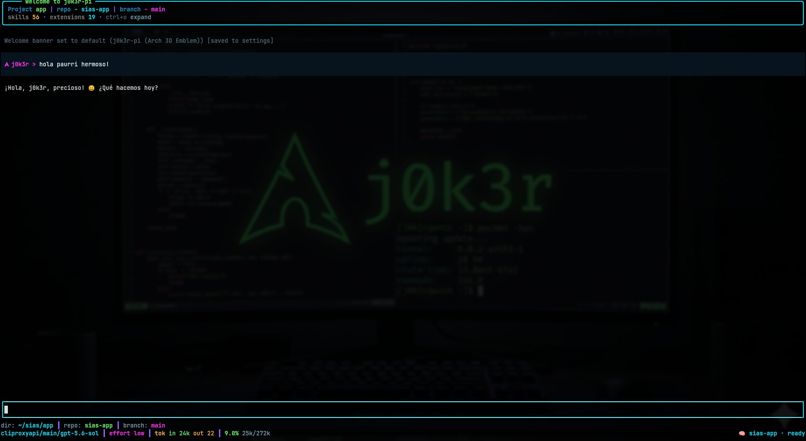
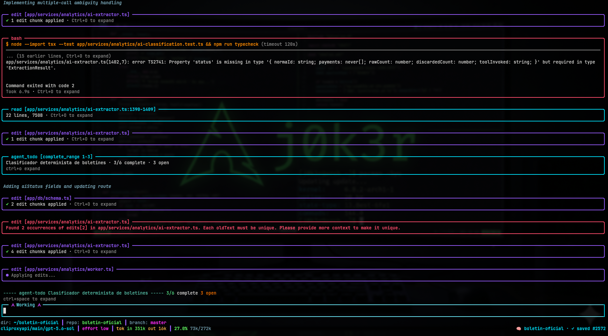
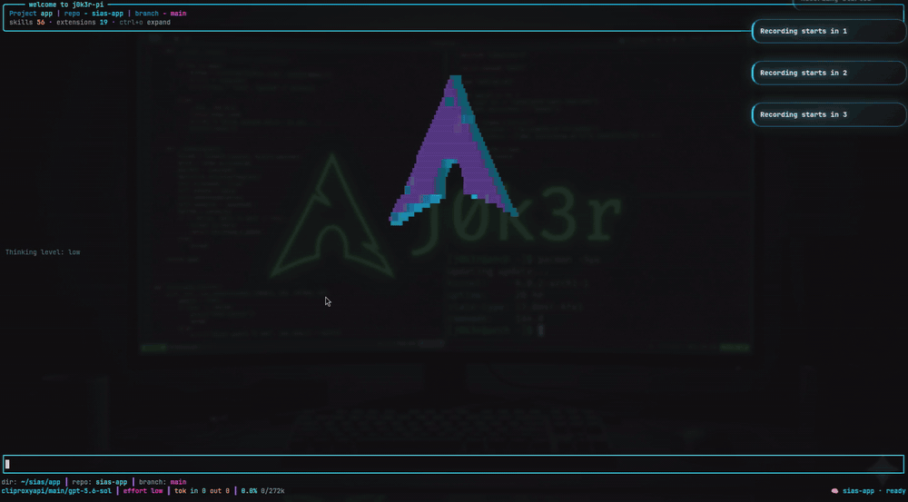
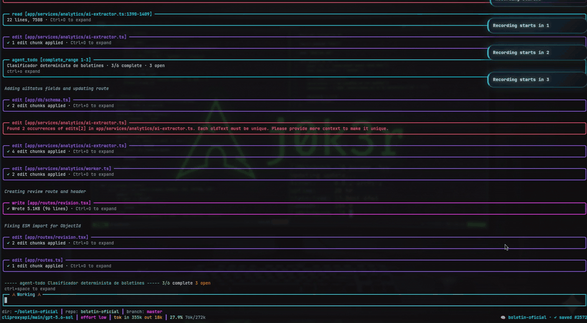

# j0k3r Pi

A personal [Pi](https://pi.dev/) coding-agent setup with native terminal UI, controlled workflows, subagents, persistent memory, research tools, and on-demand Gemini speech.

Configuración personal de [Pi](https://pi.dev/) con interfaz de terminal, workflows controlados, subagentes, memoria persistente, herramientas de investigación y voz Gemini bajo demanda.

[English](#english) · [Español](#español) · [Extensions / Extensiones](#extensions) · [Gemini TTS](extensions/google-tts/README.md) · [Keyboard shortcuts / Atajos](docs/keyboard-shortcuts.md)



<details>
<summary>More previews / Más vistas previas</summary>







These recordings illustrate the interface; individual controls may differ in the current checkout.

Las grabaciones ilustran la interfaz; algunos controles pueden variar en la versión actual.

</details>

## English

### What this repository provides

This is a customizable **agent-directory configuration**, not a standalone AI model, credential bundle, or one-command provisioner. The normal global location is `~/.pi/agent`.

- **Interactive workspace:** custom theme/editor/footer, model picker, Git diff panel, task checklist, and native decision questionnaires.
- **Controlled execution:** direct work or a lightweight planned workflow, explicit mutation/Git gates, and independent verification when using the planned route.
- **Subagents:** one delegation tool, foreground/background execution, continuation, live steering, and a history panel.
- **Persistent knowledge:** SQLite-backed memories, hybrid/lexical recall, entity relationships, and project-scoped user-message history.
- **Research and integrations:** web, academic literature, community discussions, GitHub, Context7, PDFs, YouTube, APIs, and declared workspace services.
- **Optional resilience:** supervisor dashboard, quota-aware model switching, context checkpoints/rotation, and subagent allocation.
- **Manual audio:** generate and play each final orchestrator response, pause/resume/stop, and select Gemini Flash or Flash-Lite TTS.

Use the linked extension guides for detailed behavior and requirements. Optional integrations do not become configured merely by cloning this repository.

### Installation

#### Requirements

| Component | Requirement |
|---|---|
| Pi | Install the CLI using the [official instructions](https://pi.dev/). Extension APIs are version-sensitive; check the individual guides when upgrading. |
| Node.js | **24.19 or newer** for the complete setup, including native TypeScript tests and persistent memory. Some individual extensions support older hosts. |
| npm, Git, Bash | Used for dependency installation and the examples below. |
| Model access | Configure your own Pi provider/subscription/API access. No usable credentials are supplied. |
| OS | Linux is the primary environment. Desktop capture and remote-audio recipes are Linux-specific; TTS process pause uses Linux/macOS signals. |

#### 1. Place the configuration in your agent directory

For a **new installation where `~/.pi/agent` does not already exist**:

```bash
git clone https://github.com/j0k3r-dev-rgl/j0k3r-pi.git ~/.pi/agent
cd ~/.pi/agent
```

If you already use Pi, back up your existing setup and merge deliberately instead of replacing the directory. Preserve private authentication, settings, trust decisions, sessions, and databases. Do not copy another installation's credentials or machine-specific paths into tracked files.

#### 2. Install each extension's own dependencies

From the repository root:

```bash
for extension_dir in extensions/*; do
  [ -f "$extension_dir/package.json" ] || continue
  (
    cd "$extension_dir" || exit 1
    if [ -f package-lock.json ]; then
      npm ci
    else
      npm install
    fi
  ) || break
done
```

Review dependency provenance and lifecycle scripts before installation. Native dependencies may require platform build prerequisites. The loop stops on failure; resolve it before starting Pi. There is **no root `package.json` or root test command**.

**Subagents is already included in `extensions/subagents/`.** Do not additionally install another package that registers the same tools. The local persistent-memory extension is included too; no external memory package is required.

#### 3. Configure your own model access and start Pi

Use Pi's normal provider setup (`/login` for supported providers, or your own provider configuration). CLIProxyAPI-specific quota/provider extensions are optional and require a separately configured proxy.

```bash
cd /path/to/your/project
pi
```

Pi discovers the agent directory's extensions and skills. After changing extension code, run `/reload` or restart Pi. A reload can end session-scoped resources: do not use it while subagents or other work are active without checking their lifecycle rules.

Copying a `.env.example` does **not** configure every extension: each integration has its own loading rules, described below.

### Optional integrations and private configuration

| Feature | Setup and important limits |
|---|---|
| Project opt-in tools | Open `/extension` or `/tools-manager` (`Alt+E`). The manager stores supported toggles in the project's `.pi/extensions.json`; service-specific configuration is still required. |
| Skill Registry | Separately opt in with `.pi/skill-registry.config.json` containing `{"enabled": true}`. `skill_registry_resolve` routes read-only; generation writes are a separate action. [Guide](extensions/skill-registry/README.md). |
| Persistent memory | Send a user message after loading to initialize storage lazily. Default database: `~/.memory/memories.db`. The ten memory tools include `memory_history`. E5 at `http://127.0.0.1:8000` enables embeddings; visible FTS5 fallback works without it. No old database is imported automatically. [Guide](extensions/pi-persistent-memory/README.md). |
| Supervisor | Configure and enable through `/supervisor`, with project/global scope and independent rotation/model-switch/allocation controls. Quota integration requires your proxy; checkpoints use persistent memory. It is not a Tools Manager toggle. [Guide](extensions/orchestrator-supervisor/README.md). |
| Gemini speech | In `extensions/google-tts/`, copy `.env.example` to a private `.env`, set `GOOGLE_TTS_CREDENTIALS_PATH` to the absolute path of your external service-account JSON, and protect both files. Vertex AI access and `ffplay` are required. [Credentials and audio forwarding](extensions/google-tts/README.md). |
| Context7 | Supply `CONTEXT7_API_KEY` in Pi's process environment. Optional `.pi/context7.json` controls cache/defaults, not credentials. [Guide](extensions/context7/README.md). |
| Web/research tools | Configure provider credentials in the process environment as documented. Optional global `websearch.json` is configuration, not a secret store. [Guide](extensions/websearch/README.md). |
| REST/GraphQL | Configure the exact project's `.pi/api.json`; API Tools has its own enablement and authentication contract. [Guide](extensions/api-tools/README.md). |
| Local services | Declare only the services you intend to control in `.pi/workspace-services.json`. [Guide](extensions/workspace-services/README.md). |
| Mobile notifications | The root `.env.example` illustrates optional `PI_NTFY_URL`. The question/supervisor notification integrations support their documented environment/local-file lookup. Use a private endpoint/topic; this is not a general `.env` loader. |

Local configuration such as `settings.json`, `auth.json`, `trust.json`, and `subagents.json` is excluded from this checkout's Git tracking. Create your own configuration using Pi and the extension guides; do not expect an existing user's local settings to arrive with the clone.

#### Gemini audio: commands and remote use

```text
/tts on                Enable manual controls
/tts model             Show the active speech model
/tts model flash       Select Gemini 3.8 Flash TTS (default)
/tts model lite        Select Gemini 3.8 Flash-Lite TTS
/tts generate 1        Generate response 1 without playing it
/tts play 1            Play the generated audio
/tts pause             Pause the active audio
/tts resume            Continue from the paused position
/tts stop              Stop; the next playback starts at the beginning
/tts off               Disable controls and stop playback
```

The controls appear under final responses in the **orchestrator TUI**, not in SDK subagents, RPC, JSON, or print mode. Generation and playback are always explicit. Model changes affect future generations; existing audio remains cached in memory until reload/shutdown. Model/voice/style selection is session-local.

For remote Pi over SSH/Herdr, the working Linux setup forwards **server `127.0.0.1:14713` → receiving PC `127.0.0.1:4713`**, with PulseAudio/PipeWire listening only on loopback. The receiving device must run an audio receiver; Termius alone is not one. A persistent Pi does not switch output when you attach from another device, and two tunnels cannot own the same remote port simultaneously.

Follow the [TTS README](extensions/google-tts/README.md) for the receiver command, `RemoteForward`, process environment, temporary-module limits, and troubleshooting. Keep real credential filenames and paths out of public documentation and code.

### Operating model

[`AGENTS.md`](AGENTS.md) is the authority for operating rules. The skills elaborate their own contracts; this README is an overview, not another policy owner.

| Route | Use and lifecycle |
|---|---|
| **Direct Orchestrator** | Small bounded work, targeted use of completed research with consent, or an explicit request to work without delegation. |
| **Planned Workflow** | Optional `discovery.md` → `plan.md` → authorized `apply.md` → independent `verify.md` → explicitly authorized archive. Active changes use `openspec/changes/<slug>/`. |

- [`workflow-triage`](skills/workflow-triage/SKILL.md) selects the route; [`work-workflow`](skills/work-workflow/SKILL.md) owns the planned lifecycle.
- Standalone research uses `deep-researcher`; bounded pre-implementation exploration uses `00-discovery`. Neither is a third workflow or permission to implement.
- [`anti-overengineering`](skills/anti-overengineering/SKILL.md) keeps solutions minimal. [`tdd`](skills/tdd/SKILL.md) owns behavior/regression testing; documentation changes use structural validation. TDD histories are not mandatory deliverables.
- User-owned product/configuration decisions remain explicit. File mutations are announced; commit, push, and archive have separate authorization gates.
- Checkpoints and context rotation preserve continuity, not new authority. Supervisor behavior depends on enabled controls and actual reported context; the repository does not grant arbitrary context capacity or require native compaction to be disabled.

Subagents use `subagent_run` for `run`, `continue`, and live `message` operations. Continuation requires `enable_continue`; model/effort are resolved per attempt. `/subagents` provides history and manual controls. No nested subagent delegation is allowed. See the [Subagents guide](extensions/subagents/README.md) for isolation, configuration precedence, retries, and background notifications.

### Skills and repository layout

| Path | Purpose |
|---|---|
| [`AGENTS.md`](AGENTS.md) | Authorization, workflow routing, safety, validation, memory, and Git rules. |
| [`skills/`](skills/) | Workflow owners, guardrails, and domain skills. |
| [`subagents/`](subagents/) | `00-discovery`, `01-planning`, `02-apply`, `03-verify`, `deep-researcher`, `news-researcher`, and `tool-smoke`. |
| [`extensions/`](extensions/) | Included extension implementations, package-local dependencies/tests, and detailed READMEs. |
| [`themes/`](themes/) | Theme resources, including `arch-electric`. |
| [`docs/`](docs/) | [Keyboard reference](docs/keyboard-shortcuts.md), [workflow regression guidance](docs/pi-workflow-regression-scenarios.md), and supporting reviews. |
| [`images/`](images/) | Interface previews and recordings. |

Broad topics use a router rather than loading every skill/module: [`project-documentation`](skills/project-documentation/SKILL.md) selects the relevant documentation owner, and [`pi-configuration`](skills/pi-configuration/SKILL.md) selects the configuration module. [`subagent-artifact-contracts`](skills/subagent-artifact-contracts/SKILL.md) owns delegated artifacts. The included [`typesafe-ai`](skills/typesafe-ai/SKILL.md) is a separate guidance skill; the retired TypeSafe extension is not included.

<a id="extensions"></a>

### Included extensions

Each guide below owns its exact tools, enablement, credentials, runtime requirements, and limitations. This table describes included capabilities, not a promise that every integration is active.

| Extension / guide | Main entry points and purpose |
|---|---|
| [Agent Todo](extensions/agent-todo/README.md) | `agent_todo`: one branch-aware checklist and progress widget. |
| [API Tools](extensions/api-tools/README.md) | `api_status`, authentication, REST, Swagger, and GraphQL tools. |
| [Ask User Question](extensions/ask-user-question/README.md) | `ask_user_question`: native questionnaires, previews, multiple selection, and free text. |
| [Browser Screenshot](extensions/browser-screenshot/README.md) | CDP status/tabs, `go_to_page` navigation, and page screenshots in an existing browser. |
| [CLIProxyAPI Usage](extensions/cpamc-usage/README.md) | `/usage`, `/usage --text`: account quotas and supported billing/credit views. |
| [CodeGraph](extensions/codegraph/README.md) | Status, focused nodes, exploration, impact, incremental sync, and confirmation-gated index management. |
| [Context7](extensions/context7/README.md) | Status, library resolution, and focused framework/package documentation. |
| [Git Diff Panel](extensions/git-diff-panel/README.md) | `/git-diff`, `Alt+G`: split Git/worktree diff viewer. |
| [Git Sync Awareness](extensions/git-sync-awareness/README.md) | First-message Git diagnostics; attempts bounded `git fetch origin --prune`, without automatic merge/pull/push. |
| [Google / Gemini TTS](extensions/google-tts/README.md) | `/tts`: manual per-response audio, Flash/Lite, pause/resume/stop, private `.env` configuration. |
| [Model Picker](extensions/j0k3r-model-picker/README.md) | `/model-select`, `/ms`: provider/account/model selection. |
| [Orchestrator Supervisor](extensions/orchestrator-supervisor/README.md) | `/supervisor`, `supervisor_rotate`: resilience, checkpoints, and subagent model allocation. |
| [PDF Review](extensions/pdf-review/README.md) | `pdf_extract`: local PDF text/metadata and optional OCR. |
| [Persistent Memory](extensions/pi-persistent-memory/README.md) | Ten memory tools: recall, save, graph, authorized recovery, and project user history. |
| [Skill Registry](extensions/skill-registry/README.md) | `skill_registry_resolve`, `skill_registry_generate`: read-only routing and explicit artifact generation. |
| [Subagents](extensions/subagents/README.md) | `subagent_run`, `/subagents`: delegation, continuation, live steering, and history. |
| [Theme](extensions/j0k3r-theme/README.md) | Custom header/editor/footer, animated Arch banner, and `arch-electric` palette. |
| [Tools Manager](extensions/tools-manager/README.md) | `/extension`, `/tools-manager`, `Alt+E`: project opt-in controls with deferred-reload safeguards. |
| [Utils](extensions/utils/README.md) | Linux desktop `screenshot` and local `markdown_to_audio` using Piper/eSpeak; separate from Gemini TTS. |
| [Websearch](extensions/websearch/README.md) | Web/page, discussion, academic, and GitHub search/detail tools. |
| [Workspace Services](extensions/workspace-services/README.md) | Lifecycle, status, and bounded logs for explicitly declared services. |
| [YouTube Research](extensions/youtube-research/README.md) | Search, video/transcript, channel, and playlist tools using `yt-dlp`. |

Standalone hooks also include [current date context](extensions/current-date-context.ts) and [CLIProxyAPI provider compatibility](extensions/cliproxyapi-dynamic-provider.ts). Keep local-only adapters and runtime files out of public installation assumptions.

### Validation and updates

Run only the commands provided by the owning extension. Some packages have tests and typecheck; others expose only one or use Node's native test runner.

```bash
# Example package with both scripts
(cd extensions/browser-screenshot && npm test && npm run typecheck)

# Gemini TTS: isolated/mocked tests, no Google requests or sound
(cd extensions/google-tts && node --test test/*.test.ts)

# Persistent memory: prevent real embedding/network calls during tests
(cd extensions/pi-persistent-memory && NODE_OPTIONS='--import=./test/fixtures/offline-network-guard.mjs' npm test)
```

Runtime extras are feature-specific: CodeGraph needs its CLI, YouTube needs `yt-dlp`, browser tools need an existing CDP endpoint, PDF OCR needs OCRmyPDF/Tesseract, and local Markdown audio needs Piper/eSpeak (plus `ffmpeg` for MP3). They are not all mandatory for basic Pi use.

To update this checkout, inspect local changes and upstream divergence before pulling, then reinstall dependencies where manifests/lockfiles changed and reload when safe. `pi update --extensions` applies to Pi-package-managed resources; it does not replace maintenance of this Git checkout. Do not load duplicate tool providers.

### Security and publication

- Treat extensions and dependency installation as executable code with the host user's permissions. Agent instructions and tool allowlists are not an OS sandbox.
- Never commit `.env`, credential JSON, private keys, tokens, notification endpoints, private sessions, memories, or database backups. Ignoring a file does not remove it from Git history if previously tracked.
- Publish only generic examples. Gemini's real credential path belongs in the ignored extension-local `.env`; protect it and the external JSON with owner-only access.
- Keep API/provider keys in each integration's supported private environment/auth mechanism. Review outputs and diffs without dumping the full process environment or secrets.
- Inspect the staged files **and history** before making a repository public. Secret-pattern checks are not a guarantee; revoke/rotate any exposed credential even after removing it.
- SSH audio listeners should bind to loopback, not public interfaces. Remote devices require their own receiver/tunnel configuration.
- Sessions, memory, screenshots, extracted documents, logs, and service data can contain private information. Review what an extension persists before using it with sensitive projects.
- This public repository does not certify every file, historical commit, dependency, or platform as security-audited. No repository-wide license is declared here; consult component and upstream license notices before redistribution.

---

## Español

### Qué incluye este repositorio

Es una **configuración del directorio de agente** de Pi, normalmente `~/.pi/agent`. No es un modelo independiente, un paquete de credenciales ni un instalador que configure todos los servicios automáticamente.

- **Interfaz de trabajo:** tema, editor y pie personalizados; selector de modelos, diffs de Git, checklist y cuestionarios nativos.
- **Ejecución controlada:** trabajo directo o workflow planificado ligero, autorización de cambios/Git y verificación independiente en la ruta planificada.
- **Subagentes:** delegación en primer/segundo plano, continuación, instrucciones en vivo e historial.
- **Memoria persistente:** SQLite, búsqueda híbrida/léxica, relaciones entre entidades e historial de mensajes del usuario por proyecto.
- **Investigación e integraciones:** web, fuentes académicas, comunidades, GitHub, Context7, PDF, YouTube, APIs y servicios declarados.
- **Resiliencia opcional:** supervisor, cambio de modelo según cuotas, checkpoints/rotación y asignación de modelos a subagentes.
- **Audio manual:** voz Gemini por respuesta final, Flash o Flash-Lite y controles de pausa, continuar y detener.

El [catálogo de extensiones](#extensions) enlaza cada guía detallada. Clonar el repositorio no activa ni configura por sí solo los servicios opcionales.

### Instalación

#### Requisitos

- CLI Pi instalado mediante las [instrucciones oficiales](https://pi.dev/). Las APIs de extensiones dependen de la versión del host; revisa sus guías al actualizar.
- **Node.js 24.19 o posterior** para el conjunto completo, incluidos memoria persistente y tests TypeScript nativos; algunas extensiones admiten versiones anteriores.
- npm, Git y Bash para instalar dependencias y ejecutar los ejemplos.
- Acceso propio a modelos/proveedores de Pi: no se incluyen credenciales utilizables.
- Linux como entorno principal. Capturas de escritorio y recetas de audio remoto son específicas de Linux; la pausa del reproductor usa señales de Linux/macOS.

#### 1. Ubicar la configuración

Para una **instalación nueva donde todavía no exista `~/.pi/agent`**:

```bash
git clone https://github.com/j0k3r-dev-rgl/j0k3r-pi.git ~/.pi/agent
cd ~/.pi/agent
```

Si ya usas Pi, respalda tu configuración y combina los cambios conscientemente: no reemplaces el directorio ni pierdas autenticación, ajustes, confianza, sesiones o bases de datos. No publiques credenciales ni rutas privadas de otro equipo.

#### 2. Instalar dependencias por extensión

Desde la raíz del repo:

```bash
for extension_dir in extensions/*; do
  [ -f "$extension_dir/package.json" ] || continue
  (
    cd "$extension_dir" || exit 1
    if [ -f package-lock.json ]; then
      npm ci
    else
      npm install
    fi
  ) || break
done
```

Revisa procedencia y scripts de dependencias antes de instalar. Las dependencias nativas pueden requerir herramientas de compilación de tu plataforma. El bucle se detiene si falla una instalación; resuélvela antes de iniciar Pi. **No hay `package.json` ni comando de tests en la raíz.**

**Subagents ya está incluido en `extensions/subagents/`.** No instales además otro paquete que registre las mismas herramientas. La memoria persistente también está incluida y no requiere un paquete externo.

#### 3. Configurar modelos e iniciar Pi

Usa la configuración normal de proveedores de Pi (`/login` para los compatibles o tu configuración propia). Las funciones de cuotas/proveedores CLIProxyAPI son opcionales y requieren un proxy configurado por separado.

```bash
cd /ruta/a/tu/proyecto
pi
```

Pi descubre las extensiones y skills del directorio de agente. Después de cambiar código, ejecuta `/reload` o reinicia cuando sea seguro. Recargar puede cerrar recursos de sesión: comprueba primero que no haya subagentes u otro trabajo activo.

Copiar un `.env.example` **no configura todas las extensiones**: cada integración tiene sus propias reglas de carga.

### Configuración privada e integraciones opcionales

| Función | Configuración y límites |
|---|---|
| Herramientas opt-in | `/extension` o `/tools-manager` (`Alt+E`) guarda los toggles compatibles en `.pi/extensions.json` del proyecto. Cada servicio sigue necesitando su configuración. |
| Skill Registry | Activación separada con `.pi/skill-registry.config.json` y `{"enabled": true}`. Resolver es de solo lectura; generar archivos es otra acción. [Guía](extensions/skill-registry/README.md). |
| Memoria persistente | Se inicializa al enviar un mensaje, no solo al cargar/recargar. Diez tools, incluido `memory_history`, y SQLite en `~/.memory/memories.db`. E5 en `http://127.0.0.1:8000` habilita embeddings; sin él hay fallback visible a FTS5. No importa bases anteriores automáticamente. [Guía](extensions/pi-persistent-memory/README.md). |
| Supervisor | `/supervisor` controla activación, scope global/proyecto, rotación, cambio de modelo y asignación de subagentes. Las cuotas requieren tu proxy y los checkpoints usan memoria persistente. No se activa desde Tools Manager. [Guía](extensions/orchestrator-supervisor/README.md). |
| Gemini TTS | Copia `.env.example` a un `.env` privado dentro de `extensions/google-tts/`; define `GOOGLE_TTS_CREDENTIALS_PATH` con la ruta absoluta del JSON externo y protege ambos archivos. Requiere acceso a Vertex AI y `ffplay`. [Credenciales y túnel de audio](extensions/google-tts/README.md). |
| Context7 | `CONTEXT7_API_KEY` en el entorno del proceso de Pi. `.pi/context7.json` opcional para caché/defaults, no credenciales. [Guía](extensions/context7/README.md). |
| Búsqueda web/académica | Credenciales de proveedores en el entorno según la guía; `websearch.json` global opcional para configuración, no secretos. [Guía](extensions/websearch/README.md). |
| REST/GraphQL | Configura el `.pi/api.json` exacto del proyecto; API Tools tiene su propio contrato de activación/autenticación. [Guía](extensions/api-tools/README.md). |
| Servicios locales | Declara solo los servicios que quieres controlar en `.pi/workspace-services.json`. [Guía](extensions/workspace-services/README.md). |
| Alertas móviles | El `.env.example` raíz muestra `PI_NTFY_URL` opcional. Las integraciones de cuestionarios/supervisor admiten sus búsquedas documentadas de entorno/archivo local. Usa un endpoint/tópico privado; no es un cargador general de `.env`. |

`settings.json`, `auth.json`, `trust.json` y `subagents.json` son configuración local excluida del seguimiento de Git de este checkout. Configúralos para tu instalación con Pi y sus guías; no se distribuyen los ajustes privados de otro usuario.

#### Voz Gemini: controles y conexión remota

```text
/tts on                Activar controles manuales
/tts model             Consultar el modelo de voz activo
/tts model flash       Gemini 3.8 Flash TTS (predeterminado)
/tts model lite        Gemini 3.8 Flash-Lite TTS
/tts generate 1        Generar audio de la respuesta 1 sin reproducir
/tts play 1            Reproducir el audio generado
/tts pause             Pausar el audio activo
/tts resume            Continuar desde la posición pausada
/tts stop              Detener; la próxima reproducción empieza de cero
/tts off               Desactivar controles y detener audio
```

Los controles aparecen en respuestas finales de la **TUI del orquestador**, no en subagentes SDK, RPC, JSON o modo print. Generar y reproducir son siempre acciones explícitas. Cambiar de modelo afecta a nuevas generaciones; el audio existente permanece en memoria hasta recargar/cerrar. Modelo, voz y estilo se seleccionan por sesión.

La configuración Linux probada por SSH/Herdr reenvía **servidor `127.0.0.1:14713` → PC receptor `127.0.0.1:4713`**, con PulseAudio/PipeWire escuchando solo en loopback. El dispositivo necesita un receptor de audio: Termius por sí solo no lo es. Un Pi persistente no cambia de salida al abrirlo desde otro dispositivo; dos túneles no pueden reservar el mismo puerto remoto a la vez.

El [README de TTS](extensions/google-tts/README.md) contiene el receptor, `RemoteForward`, variables del proceso, duración temporal del módulo y diagnóstico. El nombre y la ruta reales de credenciales nunca deben estar en documentación pública ni código.

### Workflows y subagentes

[`AGENTS.md`](AGENTS.md) es la fuente de autoridad de las reglas operativas. Este README las resume; no añade otra política.

| Ruta | Uso y ciclo |
|---|---|
| **Direct Orchestrator** | Trabajo pequeño acotado, aplicación autorizada de investigación completa o petición explícita de trabajar sin delegar. |
| **Planned Workflow** | `discovery.md` opcional → `plan.md` → `apply.md` autorizado → `verify.md` independiente → archivo con autorización expresa. Cambios activos en `openspec/changes/<slug>/`. |

- [`workflow-triage`](skills/workflow-triage/SKILL.md) selecciona la ruta; [`work-workflow`](skills/work-workflow/SKILL.md) gobierna el ciclo planificado.
- `deep-researcher` cubre investigación independiente; `00-discovery`, exploración local previa a implementar. No son un tercer workflow ni autorización de implementación.
- [`anti-overengineering`](skills/anti-overengineering/SKILL.md) limita complejidad; [`tdd`](skills/tdd/SKILL.md) gobierna tests de comportamiento/regresión. La documentación se valida estructuralmente; los historiales TDD no son entregables obligatorios.
- Decisiones materiales de producto/configuración, commit, push y archivo mantienen sus autorizaciones. Se anuncian las modificaciones antes de ejecutarlas.
- Checkpoints y rotación conservan continuidad, no otorgan autoridad nueva. Dependen de controles activos y uso real de contexto; el repo no garantiza capacidad arbitraria ni exige desactivar la compactación nativa.

`subagent_run` concentra `run`, `continue` y `message` en vivo. Continuar requiere `enable_continue`; modelo/esfuerzo se resuelven por intento. `/subagents` ofrece historial y controles manuales. Los subagentes no delegan a otros subagentes. La [guía](extensions/subagents/README.md) documenta aislamiento, precedencia de configuración, reintentos y notificaciones background.

### Estructura y extensiones

| Ruta | Contenido |
|---|---|
| [`AGENTS.md`](AGENTS.md) | Autorización, routing, seguridad, validación, memoria y Git. |
| [`skills/`](skills/) | Owners de workflow, guardrails y skills de dominio. |
| [`subagents/`](subagents/) | Discovery, planificación, implementación, verificación, investigación, noticias y smoke tests. |
| [`extensions/`](extensions/) | Código, dependencias/tests propios y READMEs de extensiones incluidas. |
| [`themes/`](themes/) | Temas, incluido `arch-electric`. |
| [`docs/`](docs/) | [Atajos](docs/keyboard-shortcuts.md), [regresiones de workflow](docs/pi-workflow-regression-scenarios.md) y revisiones de apoyo. |
| [`images/`](images/) | Capturas y grabaciones de la interfaz. |

Consulta el [catálogo único de extensiones](#extensions), con enlaces a todas las guías. Incluye TTS, Subagents e indicadores Git; la antigua extensión TypeSafe ya no está. La skill [`typesafe-ai`](skills/typesafe-ai/SKILL.md) es orientación independiente, no esa extensión.

Las familias amplias usan routers: [`project-documentation`](skills/project-documentation/SKILL.md) selecciona el owner documental pertinente y [`pi-configuration`](skills/pi-configuration/SKILL.md) el módulo de configuración. [`subagent-artifact-contracts`](skills/subagent-artifact-contracts/SKILL.md) define los artefactos de delegación.

### Validación y actualizaciones

Usa los comandos de cada extensión: no todas tienen `test` y `typecheck`, y algunas emplean el runner nativo de Node.

```bash
# Paquete con tests y typecheck
(cd extensions/browser-screenshot && npm test && npm run typecheck)

# Gemini TTS: pruebas aisladas/simuladas, sin Google ni sonido
(cd extensions/google-tts && node --test test/*.test.ts)

# Memoria: bloquear llamadas reales a embeddings/red durante pruebas
(cd extensions/pi-persistent-memory && NODE_OPTIONS='--import=./test/fixtures/offline-network-guard.mjs' npm test)
```

Las dependencias runtime son por función: CLI de CodeGraph, `yt-dlp` para YouTube, navegador con CDP, OCRmyPDF/Tesseract para OCR y Piper/eSpeak para audio local de Markdown (`ffmpeg` para MP3). No son todas necesarias para usar Pi.

Para actualizar este checkout, revisa cambios locales y divergencia antes de hacer pull, reinstala dependencias donde cambien manifiestos/lockfiles y recarga cuando sea seguro. `pi update --extensions` actualiza recursos gestionados como paquetes de Pi; no sustituye el mantenimiento de este clon Git. Evita proveedores duplicados de herramientas.

### Seguridad y publicación

- Extensiones y dependencias son código ejecutable con los permisos de tu usuario. Instrucciones y allowlists no equivalen a un sandbox del sistema operativo.
- No subas `.env`, JSON de credenciales, claves privadas, tokens, endpoints de notificación, sesiones privadas, memorias ni backups de bases de datos. `.gitignore` no borra archivos que ya estuvieran en el historial.
- Publica solo ejemplos genéricos. La ruta real de Gemini vive en el `.env` privado de la extensión; protege ese archivo y el JSON externo para que solo el propietario tenga acceso.
- Usa el mecanismo privado de entorno/autenticación admitido por cada integración. No vuelques el entorno completo ni secretos para revisar resultados o diffs.
- Revisa lo preparado para commit **y el historial** antes de publicar. Un escaneo por patrones no garantiza ausencia de secretos; revoca/rota cualquier credencial expuesta aunque después la borres.
- Mantén receptores SSH de audio en loopback, no interfaces públicas. Cada dispositivo necesita su receptor/túnel.
- Sesiones, memoria, capturas, documentos extraídos, logs y datos de servicios pueden ser privados. Comprueba qué persiste cada extensión antes de usarla con proyectos sensibles.
- Este repo público no certifica una auditoría completa de archivos, historial, dependencias o plataformas. No se declara aquí una licencia global: revisa avisos de licencia de componentes y proyectos originales antes de redistribuir.
